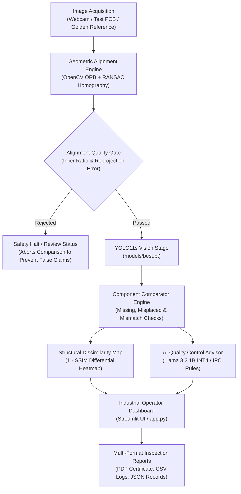

# Bharat AI – EdgeInspect AI

**Real-Time Industrial Defect Detection & Quality-Control Assistant**  
*Submitted under the Manufacturing & Industry 4.0 Theme for the Arm Bharat AI-SoC Challenge 2026–27 (Problem Statement 5)*

[-red.svg)](https://www.raspberrypi.com/products/raspberry-pi-5/)
[](https://docs.ultralytics.com/)
[](https://opencv.org/)
[](https://pytorch.org/executorch/)
[-purple.svg)](https://huggingface.co/meta-llama)
[](https://www.python.org/)

---

## 📌 Project Overview: PCB Missing & Misplaced Component Inspection

**EdgeInspect AI** is an edge-native automated optical inspection (AOI) system designed for real-time visual quality assurance of Printed Circuit Board (PCB) assemblies on electronics manufacturing lines. Developed for the **Arm Bharat AI-SoC Challenge 2026–27 (PS5)**, the system detects critical surface-mount assembly defects on-device without cloud connectivity, ensuring low inspection latency, complete data privacy, and full operational autonomy.

While generic object detection identifies component classes, the primary core objective of **EdgeInspect AI** is **reference-guided anomaly detection**:
1. **Missing Component Detection**: Verifies expected components against a golden reference standard and pinpoints components absent from designated footprints.
2. **Misplaced Component Detection**: Identifies components that are present on the board but mounted with spatial drift or angular displacement exceeding IPC manufacturing tolerances.
3. **Class Mismatch & Extra Part Detection**: Flags incorrect components placed on designated pads or uncataloged foreign objects on the PCB.
4. **On-Device LLM Defect Advisory**: Translates quantitative spatial deltas into plain-language root-cause diagnostics and rework guidance for assembly line operators using a local quantized language model.

---

## 🎯 Problem Statement & Objectives

* **Problem Statement**: Arm Bharat AI-SoC Challenge 2026–27 — **PS5: Real-time Industrial Defect Detection & Quality-Control Assistant**.
* **Target Objective**: Build an on-device AI system that performs real-time visual inspection of manufactured assemblies, isolates missing and misplaced components, classifies defect severity, and assists factory-floor QC technicians with actionable remediation advice.

### Core Engineering Objectives
* **Sub-Pixel Geometric Alignment**: Align test PCB images against a known-good golden reference PCB under perspective variation and lighting changes using ORB feature matching and RANSAC homography estimation.
* **Strict Safety Gating**: Implement fail-safe quality gates that halt automated comparison when image alignment is sub-optimal, preventing false pass/fail verdicts.
* **Spatial Discrepancy Matching**: Match reference and test bounding boxes using dual IoU and Euclidean centroid-drift metrics to distinguish normal manufacturing jitter from genuine misplacement defects.
* **Illumination-Normalized Structural Dissimilarity**: Compute $(1 - \text{SSIM})$ differential heatmaps to visualize physical surface defects.
* **On-Edge LLM Operator Advisory**: Execute **Llama 3.2 1B Instruct (SpinQuant INT4)** locally on ARM64 CPU via **ExecuTorch 1.5** (with deterministic IPC quality engineering rules as fallback).
* **Industrial Touch-Ready Interface**: Host an interactive Streamlit edge dashboard with camera ingestion, defect visualization overlays, technician Q&A, and downloadable audit certificates (PDF, CSV, JSON).

---

## 🏗️ System Architecture & Workflow

EdgeInspect executes its complete inspection pipeline on-chip:



### Module Responsibilities

| Directory / File | Component | Primary Responsibility |
| :--- | :--- | :--- |
| `src/aligner.py` | Geometric Alignment Engine | Extracts ORB features, matches descriptors, computes RANSAC homography, and validates inlier ratios. |
| `src/detector.py` | Object Detection Stage | Loads `models/best.pt` in read-only mode to extract component classes and bounding boxes. |
| `src/comparator.py` | Defect Comparator Engine | Matches reference and test components; flags missing, misplaced, mismatch, and extra components. |
| `src/inspector.py` | Inspection Orchestrator | Coordinates alignment, vision inference, discrepancy detection, and overall safety verdicts. |
| `src/advisor.py` | AI Operator Advisor | Formulates root-cause analysis and rework instructions via local ExecuTorch Llama 3.2 or IPC rule engine. |
| `src/visualizer.py` | Defect Visualizer | Renders side-by-side comparison panels, bounding box overlays, and cropped defect callouts. |
| `src/reporter.py` | Multi-Format Reporter | Generates timestamped PDF inspection certificates, CSV defect logs, and JSON audit files. |
| `src/camera.py` | Ingestion & Capture Helper | Handles image byte decoding, sanity checks, and camera frame normalization. |
| `src/config.py` | Central Configuration | Manages paths, component classes, color palettes, and defect tolerance thresholds. |
| `app.py` | Operator Dashboard | Streamlit-based dark industrial operator cockpit with live inspection controls. |

---

## 🔍 Defect Detection Methodology

### 1. Missing Component Detection
- **Reference Footprint Registration**: Every component detected on the golden reference PCB defines an expected footprint $(x_1, y_1, x_2, y_2)$ and class label $C_{\text{ref}}$.
- **Occupancy Verification**: Following alignment, the test PCB's component detections are evaluated within the reference bounding box.
- **Defect Criterion**: If no test detection of class $C_{\text{ref}}$ achieves an $\text{IoU} \ge 0.30$ with the reference footprint, the component is classified as **MISSING (CRITICAL)**.

### 2. Misplaced Component Detection
- **Centroid Drift Analysis**: For components successfully matched by class and overlapping footprint, Euclidean centroid distance $d$ is calculated:
  $$d = \sqrt{(c_{x,\text{ref}} - c_{x,\text{test}})^2 + (c_{y,\text{ref}} - c_{y,\text{test}})^2}$$
- **Manufacturing Jitter Guard**: Small spatial deviations ($d \le 20.0\text{ px}$) are accepted as normal pick-and-place placement tolerance.
- **Defect Criterion**: When centroid displacement exceeds the allowable limit ($d > 20.0\text{ px}$), the component is classified as **MISPLACED (HIGH)** with exact pixel shift vector and rework coordinates.

### 3. Component Class Mismatch & Extra Parts
- **Class Mismatch**: Detected when a component occupies a designated reference pad but exhibits a different component classification (e.g., resistor placed on capacitor footprint).
- **Extra Component**: Detected when an uncataloged component is identified on the test board without a corresponding reference pad.

### 4. Safety-Gated Alignment Verification
- Automatic alignment requires a minimum of 100 good matches and an inlier ratio $\ge 0.15$.
- If alignment fails (e.g., due to extreme glare, severe occlusion, or incorrect board orientation), inspection is immediately **HALTED** with status `REVIEW`, preventing false defect diagnoses.

---

## 🤖 Llama-Based Defect Recommendation Engine

EdgeInspect integrates an on-device AI advisor (`src/advisor.py`) that operates locally on the edge device:

1. **ExecuTorch Llama 3.2 1B Instruct (SpinQuant INT4)**:
   - When ExecuTorch and model weights are present, the advisor synthesizes contextual root-cause engineering analyses and rework steps on-device.
   - Evaluated on Raspberry Pi 5 ARM64 CPU: **2.59 s load time**, **99.14 tokens/s prefill**, and **13.72 tokens/s generation throughput**.
2. **Deterministic IPC Quality Engineering Fallback**:
   - When LLM model weights are not loaded, the advisor falls back seamlessly to a deterministic electronics quality engineering rules engine.
   - Generates structured root causes, IPC-A-610 rework procedures, solder paste inspection recommendations, and pick-and-place feeder diagnostic guidance.

---

## ⚙️ Hardware Platform & Raspberry Pi 5 Deployment

| Parameter | Specification |
| :--- | :--- |
| **Edge Compute** | **Raspberry Pi 5 (8 GB RAM)** |
| **Processor** | Broadcom BCM2712 Quad-core ARM Cortex-A76 @ 2.4 GHz |
| **Operating System** | ARM64 Debian GNU/Linux 13 (Trixie) / Raspberry Pi OS 64-bit |
| **Deployment Root** | `/home/edgeuser/edgeinspect` |
| **Hardware Config** | `deployment/raspberry_pi5/config.txt` |
| **Boot Parameters** | `deployment/raspberry_pi5/cmdline.txt` |
| **System Service** | `deployment/raspberry_pi5/edgeinspect.service` |

### Deployment Setup Files
All deployment configurations from the edge SD card are organized in `deployment/raspberry_pi5/`:
- `config.txt`: Hardware camera auto-detect, display overlays, 64-bit ARM boost, and VC4 V3D driver settings.
- `cmdline.txt`: Kernel boot parameters and PARTUUID root filesystem configuration.
- `network-config.example`: Sanitized cloud-init Wi-Fi and Ethernet configuration template.
- `user-data.example`: Sanitized cloud-init user setup and SSH enablement template.
- `edgeinspect.service`: Systemd unit file for auto-starting the inspection cockpit on boot.

---

## 🚀 Installation & Quickstart

### 1. Prerequisites
- Python 3.10+ (tested on Python 3.11 & 3.12)
- Git

### 2. Clone Repository & Install Dependencies
```bash
git clone https://github.com/Sanjay-JS-29/Bharat-AI-EdgeInspect.git
cd Bharat-AI-EdgeInspect

python3 -m venv .venv
source .venv/bin/activate
pip install --upgrade pip
pip install -r requirements.txt
```

> **Note for Headless Raspberry Pi 5**: Install `opencv-python-headless` instead of `opencv-python` to avoid X11/GUI display dependencies:
> ```bash
> pip install opencv-python-headless
> ```

### 3. Verify Model Integrity
Confirm that `models/best.pt` matches the official weights:
```bash
shasum -a 256 models/best.pt
# Expected SHA-256: 3bed9c0193f7813acb8b5a3acbe462dffc49aab4a86f17c92119b69479ce5552
# Size: 40,506,412 bytes (~40.5 MB)
```

---

## 💻 Running the Application

Launch the Streamlit industrial inspection cockpit:
```bash
streamlit run app.py
```
Open your browser to `http://localhost:8501`.

### Operator Workflow in the Cockpit:
1. **Upload Golden Reference PCB**: Load a known-good standard board image.
2. **Provide Test Board Image**: Upload an assembled test PCB image or capture directly using a connected camera.
3. **Execute Inspection**: Click **Inspect PCB** to run geometric alignment, YOLO component inference, and spatial defect comparison.
4. **Review Defect Analysis**: Inspect the annotated overlay, cropped defect panel, and $(1 - \text{SSIM})$ difference heatmap.
5. **Consult AI Advisor**: Read the automated root-cause diagnosis and ask questions via the interactive technician Q&A console.
6. **Export Audit Reports**: Download timestamped PDF inspection certificates, CSV logs, or JSON records.

---

## 🧪 Executing the Test Suite

The repository includes a comprehensive verification suite in `tests/`:

```bash
# Run component comparator tests (missing & misplaced detection)
python3 tests/test_comparator.py

# Run missing, extra, and safety gating tests
python3 tests/test_missing_extra.py

# Run AI advisor and technician Q&A tests
python3 tests/test_advisor.py

# Run OpenCV alignment engine tests
python3 tests/test_alignment.py

# Run camera and byte decoding tests
python3 tests/test_camera.py

# Run report generator tests (PDF, CSV, JSON)
python3 tests/test_reporter.py

# Run defect visualization tests
python3 tests/test_visualizer.py

# Run stage 1 vision tests
python3 tests/test_stage1.py

# Run edge-case robustness tests
python3 tests/test_edge_cases.py

# Run application logic tests
python3 tests/test_app_logic.py

# Run edge performance benchmark (latency & throughput)
python3 tests/benchmark_performance.py
```

---

## 📁 Repository Directory Structure

```text
Bharat-AI-EdgeInspect/
├── README.md                      # Comprehensive project documentation
├── .gitignore                     # Git ignore rules for virtual environments, caches & secrets
├── requirements.txt               # Python package dependency manifest
├── app.py                         # Streamlit industrial inspection UI & operator cockpit
│
├── src/                           # Core inspection engine package
│   ├── __init__.py                # Package initialization
│   ├── config.py                  # Thresholds, class names, color palettes, & path config
│   ├── detector.py                # YOLOv11s object detection engine
│   ├── aligner.py                 # OpenCV ORB feature alignment & homography quality gating
│   ├── comparator.py              # Component comparator (missing, misplaced, mismatch detection)
│   ├── advisor.py                 # AI QC Advisor (ExecuTorch Llama 3.2 1B & QC rules fallback)
│   ├── inspector.py               # End-to-end inspection orchestrator with safety gates
│   ├── camera.py                  # Image acquisition, byte decoding, & format validation
│   ├── visualizer.py              # Defect overlays, bounding boxes, & comparison panels
│   └── reporter.py                # Multi-format report generator (PDF, CSV, JSON)
│
├── tests/                         # Verification test suites & performance benchmarks
│   ├── test_comparator.py         # Missing & misplaced component test suite
│   ├── test_missing_extra.py      # Missing/extra component detection & safety gating
│   ├── test_advisor.py            # Llama 3.2 1B advisor & technician Q&A tests
│   ├── test_alignment.py          # OpenCV ORB/RANSAC alignment verification
│   ├── test_camera.py             # Image decoding and camera input tests
│   ├── test_reporter.py           # Multi-format report generation tests
│   ├── test_visualizer.py         # Defect visualization tests
│   ├── test_stage1.py             # Vision stage detection tests
│   ├── test_edge_cases.py         # Boundary and corruption handling
│   ├── verify_stage1.py           # Stage 1 verification pipeline
│   ├── test_app_logic.py          # Application workflow tests
│   └── benchmark_performance.py   # Latency, throughput, and memory benchmark
│
├── deployment/
│   └── raspberry_pi5/             # Raspberry Pi 5 deployment configs from SD card
│       ├── config.txt             # Hardware overlays, ARM64 boost, & camera auto-detect
│       ├── cmdline.txt            # Kernel boot parameters
│       ├── network-config.example # Sanitized cloud-init network template (credentials stripped)
│       ├── user-data.example      # Sanitized cloud-init user setup template (password sanitized)
│       └── edgeinspect.service    # Systemd service unit for automated headless boot
│
├── results/                       # Empirical evaluation artifacts & validation screenshots
│   ├── visualizations/            # 15 defect & pass/fail annotated PCB images
│   └── reports/                   # Sample generated inspection audit certificates & logs
│       ├── test_report_pass.json
│       ├── test_report_fail.csv
│       ├── bharatpcb_report_20261125_145241_212.pdf
│       ├── bharatpcb_report_20261125_145241_212.json
│       └── bharatpcb_report_20261125_145241_212.csv
│
├── docs/                          # Project reports & presentation
│   └── Bharat_AI_Report.pdf       # 13-page final project submission report
│
├── notebooks/                     # Model training & experiment workflows
│   └── EdgeInspect_PCB_AI.ipynb   # YOLO11s fine-tuning and evaluation notebook
│
└── models/
    └── best.pt                    # Trained YOLO11s model checkpoint (40.5 MB, preserved)
```

---

## 📊 Validation Results & Screenshots

The `results/visualizations/` folder contains high-resolution verification artifacts generated by the inspection pipeline:

* **Misplaced Component Localization**: Accurately flags component shifts exceeding placement tolerance (e.g. `vis_20261125_100425_207_20261125_100425_208.png`).
* **Missing Component Identification**: Localizes empty reference pads where components are absent (e.g. `vis_20261125_100456_567_20261125_100456_568.png`).
* **Clean Passing Assemblies**: Validates fault-free boards with complete component inventories (e.g. `test_vis_pass_20261125_100412_485.png`).
* **Inspection Audit Reports**: PDF certificates (`results/reports/*.pdf`), CSV defect summaries, and structured JSON logs for factory MES integration.

---

## 👥 Project Team & Institutional Details

* **Institution**: [Atria Institute of Technology](https://atria.edu/), Bengaluru *(An Autonomous Institution, Affiliated to VTU)*
* **Department**: Department of Electronics and Communication Engineering (ECE)
* **Challenge**: **Arm Bharat AI-SoC Challenge 2026–27**
* **Problem Statement**: **PS5 — Real-Time Industrial Defect Detection & Quality-Control Assistant**
* **Submission Date**: 25 November 2026

### Team Members
* **Abhinand Nityanandan** — *Team Lead*
* **Sanjay JS** — *Team Member* ([@Sanjay-JS-29](https://github.com/Sanjay-JS-29))
* **Thrilok Shekar** — *Team Member*

### Faculty Guide
* **Dr. Rakhi** — *Faculty Guide, Department of ECE, Atria Institute of Technology*
