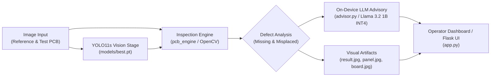

# Bharat AI – EdgeInspect AI

**Real-Time Industrial Defect Detection & Quality-Control Assistant**  
*Submitted under the Manufacturing & Industry 4.0 Theme for the Arm Bharat AI-SoC Challenge 2026–27 (Problem Statement 5)*

[-red.svg)](https://www.raspberrypi.com/products/raspberry-pi-5/)
[](https://docs.ultralytics.com/)
[](https://pytorch.org/executorch/)
[-purple.svg)](https://huggingface.co/meta-llama)
[](https://www.python.org/)

---

## 📌 Executive Summary

**EdgeInspect** is an edge-native AI inspection system engineered for real-time visual quality assurance of Printed Circuit Board (PCB) assemblies on factory floors. Developed for the **Arm Bharat AI-SoC Challenge 2026–27 (PS5)**, the system detects critical surface assembly faults without relying on cloud connectivity, preserving low latency, factory-floor data privacy, and full offline autonomy.

The system focuses on two critical PCB assembly defects:
1. **Missing Components**: Verifies expected components against a known-good reference board and flags components that are absent.
2. **Misplaced Components**: Identifies components that are present but mounted at incorrect coordinates or orientations relative to the reference footprint.

Inspection findings are processed by an on-device language assistant that provides human operators with plain-language diagnostics and actionable quality-control recommendations.

---

## 🎯 Problem Statement & Objectives

* **Problem Statement**: Arm Bharat AI-SoC Challenge 2026–27 — **PS5: Real-time Industrial Defect Detection & Quality-Control Assistant**.
* **Target Objective**: Build an on-device AI system that performs real-time visual inspection of manufactured components, detects surface anomalies, classifies defect severity, and assists factory-floor QC operators with actionable guidance without cloud dependence.

### Key Objectives
* **Reference-Based PCB Inspection**: Compare a known-good golden reference PCB image against an inspected PCB to accurately localize missing and misplaced parts.
* **On-Edge Vision Localisation**: Deploy a lightweight `YOLO11s` detector checkpoint (`models/best.pt`) on an edge SoC to extract bounding box coordinates across 9 PCB component classes.
* **Structural Anomaly Verification**: Utilize OpenCV image processing and structural dissimilarity ($1 - \text{SSIM}$) to isolate assembly deltas.
* **On-Device LLM Operator Advisory**: Run a quantized language model (`Llama 3.2 1B Instruct` in SpinQuant INT4 format) locally via **ExecuTorch 1.5** on ARM64 CPU to produce concise operator alerts and remediation steps.
* **Lightweight Local Service**: Host an edge Flask service providing endpoints for reference registration, test inspection, and system status telemetry.

---

## 🏗️ System Architecture

EdgeInspect operates strictly on the edge device (Raspberry Pi 5). The inspection workflow executes entirely on-chip:



### Architectural Layers & Module Responsibilities

| Layer / Module | Component / File | Primary Responsibility |
| :--- | :--- | :--- |
| **Image Acquisition** | `data/reference.jpg` + Test Frame | Captures or loads the golden reference PCB and inspected board images via local camera/file ingestion. |
| **Supporting Vision Detector** | `models/best.pt` | `YOLO11s` model checkpoint loaded once into memory at startup; extracts component bounding boxes across 9 classes. |
| **Defect Comparison Engine** | `pcb_engine` | Performs alignment, reference-to-test bounding-box matching, footprint occupancy checks, and $(1 - \text{SSIM})$ difference mapping. |
| **Operator Advisory** | `advisor.py` | Ingests structured defect parameters (component class, bounding box, spatial delta) and invokes **Llama 3.2 1B INT4** to produce operator recommendations; includes rule-based fallback. |
| **Edge Application Service** | `app.py` | Exposes local Flask endpoints (`/set_ref`, `/inspect`, `/status`) and renders operator interfaces. |
| **Local Persistence** | `results/` | Stores annotated defect overlays, composite panels, and inspection logs on local storage for quality traceability. |

---

## ⚙️ Hardware Platform & Deployment Environment

| Specification | Target Configuration |
| :--- | :--- |
| **SoC / Compute** | **Raspberry Pi 5 (8 GB RAM)** |
| **Processor** | Broadcom BCM2712, Quad-core ARM Cortex-A76 @ 2.4 GHz |
| **Operating System** | ARM64 Debian GNU/Linux 13 (Trixie) |
| **Available Resources at Setup** | 4 CPU Cores, ~7.6 GB free RAM, ~14 GB free storage |
| **Image Source** | USB webcam / Smartphone camera integration (tested via ADB/SCP with Redmi 10) |
| **Deployment Root** | `/home/edgeuser/edgeinspect/` |
| **Model Path** | `/home/edgeuser/edgeinspect/models/best.pt` |

---

## ⚡ Edge Optimization Techniques

To achieve responsive performance within the constrained compute and thermal budget of a Raspberry Pi 5 CPU, the following optimization strategies were implemented:

1. **SpinQuant INT4 LLM Quantization**:
   - Quantized `Llama 3.2 1B Instruct` weights into SpinQuant INT4 format.
   - Slashes memory footprint, fitting comfortably within available edge RAM and reducing CPU memory bandwidth bottlenecks.
2. **ExecuTorch 1.5 ARM64 CPU Runtime**:
   - Executed through PyTorch's specialized on-device runtime (**ExecuTorch 1.5**), compiling operations for native ARM64 NEON/SIMD execution.
3. **Single Warm Initialization ("Load Model Once")**:
   - The vision detector (`models/best.pt`) is loaded into memory during Flask server boot.
   - Eliminates redundant multi-second disk I/O and graph compilation delays on individual inspection requests.
4. **Decoupled Modular Pipeline**:
   - Strict separation of concerns between `app.py` (serving), `pcb_engine` (computer vision), and `advisor.py` (language synthesis) enables independent testing, debugging, and graceful fallback.
5. **Zero-Cloud Local Persistence**:
   - Eliminates round-trip network latency and prevents factory IP/inspection images from leaving local storage.

---

## 📊 Experimental Results & Validation

### 1. Language Assistant Runtime on Raspberry Pi 5 CPU

*Evaluated with **Llama 3.2 1B Instruct (SpinQuant INT4)** running on Raspberry Pi 5 CPU via **ExecuTorch 1.5**:*

| Runtime Metric | Recorded Value |
| :--- | :--- |
| **Model Load Time** | **2.59 s** |
| **Prompt Prefill Throughput** | **99.14 tokens/s** |
| **Token Generation Throughput** | **13.72 tokens/s** |
| **Demonstrated Output Length** | **79 tokens** |

> *Note: These figures measure isolated edge LLM recommendation generation speed on the ARM64 CPU and do not include camera capture or vision inference latency.*

### 2. Defect Detection & Visual Validation

* The system was validated against physical PCB defect scenarios:
  * **Misplaced Component Scenario**: A capacitor shifted from reference coordinates `(x, y, w, h) = (359, 170, 66, 71)` to `(264, 238, 66, 71)` (movement: 117 px; confidence: 0.74).
  * **Engine Output**: Correctly identified the empty reference footprint and detected the component at the new position.
  * **Artifacts Generated**:
    * `result.jpg`: Annotated bounding boxes marking original and displaced locations.
    * `panel.jpg`: Comparative multi-panel visualizer showing reference board, test board, and differential heatmap.
    * `board.jpg`: High-resolution defect highlighting.
    * $(1 - \text{SSIM})$: Structural difference map highlighting physical anomalies.
  * **Advisory Output**: Local Llama model generated clear operator instructions detailing component identity, shift vector, and recommended rework actions.

---

## 📁 Repository Structure

```text
Bharat-AI-EdgeInspect/
├── README.md                      # Comprehensive project documentation
├── models/
│   └── best.pt                    # Trained YOLO11s PyTorch model checkpoint (40.5 MB)
├── data/
│   └── reference.jpg              # Golden reference PCB image (known-good standard)
├── pcb_engine/
│   ├── __init__.py
│   ├── comparator.py              # Reference-to-test bounding box and footprint matcher
│   ├── visualizer.py              # Generates result.jpg, panel.jpg, and SSIM heatmaps
│   └── ssim_diff.py               # Structural similarity index calculation
├── advisor.py                     # ExecuTorch Llama 3.2 1B INT4 / rule-based advisory module
├── app.py                         # Edge Flask service (exposes /set_ref, /inspect, /status)
└── requirements.txt               # Python package dependencies
```

---

## 🚀 Quickstart & Setup Guide

### 1. Hardware & OS Setup (Raspberry Pi 5)
Ensure your Raspberry Pi 5 is running **ARM64 Debian 13 (or Raspberry Pi OS Bookworm 64-bit)**:
```bash
uname -m  # Verify 'aarch64'
free -h   # Verify 8 GB RAM
```

### 2. Clone Repository & Setup Virtual Environment
```bash
git clone https://github.com/Sanjay-JS-29/Bharat-AI-EdgeInspect.git
cd Bharat-AI-EdgeInspect

python3 -m venv venv
source venv/bin/activate
pip install --upgrade pip
pip install -r requirements.txt
```

### 3. Verify Model Integrity
Ensure the model checkpoint in `models/best.pt` matches the official weights:
```bash
shasum -a 256 models/best.pt
# Expected SHA-256: 3bed9c0193f7813acb8b5a3acbe462dffc49aab4a86f17c92119b69479ce5552
# Size: 40,506,412 bytes (~40.5 MB)
```

### 4. Run Edge Application
```bash
python3 app.py --port 5000
```

### 5. API Endpoints

* **Set Reference Board**:
  ```bash
  curl -X POST -F "image=@data/reference.jpg" http://localhost:5000/set_ref
  ```
* **Inspect Test Board**:
  ```bash
  curl -X POST -F "image=@test_pcb.jpg" http://localhost:5000/inspect
  ```
* **System Status & Health**:
  ```bash
  curl http://localhost:5000/status
  ```

---

## 🔍 Limitations & Future Scope

### Practical Considerations & Current Limitations
* **Capture Geometry & Illumination**: Reference-board comparison is sensitive to camera angle, distance, lighting reflections, and shadow variations. A standardized capture jig or lighting envelope is recommended.
* **Independent Defect Quantification**: While missing- and misplaced-component detection routines are fully implemented, a standalone, independently labeled multi-board dataset is required to publish independent precision/recall confusion matrices.
* **Continuous Streaming Pipeline**: File-based ingestion (ADB/SCP and static uploads) is verified; continuous live USB webcam streaming directly into the inference loop is slated for full validation.

### Engineering Roadmap
* [ ] Integrate camera autofocus and homographic planar alignment directly into `pcb_engine`.
* [ ] Benchmark full end-to-end latency (capture $\rightarrow$ vision $\rightarrow$ comparison $\rightarrow$ LLM advice $\rightarrow$ UI).
* [ ] Evaluate INT8 quantization for the `YOLO11s` vision checkpoint using Arm NN / CMSIS-NN.
* [ ] Implement exportable quality-control CSV/PDF shift audit logs.

---

## 👥 Project Team & Institutional Details

* **Institution**: [Atria Institute of Technology](https://atria.edu/), Bengaluru *(An Autonomous Institution, Affiliated to VTU)*
* **Department**: Department of Electronics and Communication Engineering (ECE)
* **Challenge**: **Arm Bharat AI-SoC Challenge 2026–27**
* **Problem Statement**: **PS5 — Real-Time Industrial Defect Detection & Quality-Control Assistant**
* **Submission Date**: 25 November 2026

### Team Members
* **Abhinand Nityanandan** — *Team Lead*
* **Sanjay JS** — *Team Member* ([@Sanjay-JS-29](https://github.com/Sanjay-JS-29))
* **Thrilok Shekar** — *Team Member*

### Faculty Guide
* **Dr. Rakhi** — *Faculty Guide, Department of ECE, Atria Institute of Technology*

---

## 📚 References & Evidence
1. **Arm Developer Labs**: *Bharat AI-SoC Challenge 2026–27*, PS5: "Real-time industrial defect detection & quality-control assistant".
2. **YOLO11s Model Checkpoint**: Development validation records from `YOLO11s_Tiled_Experiment` deployed at `models/best.pt`.
3. **ExecuTorch Documentation**: ExecuTorch 1.5 ARM64 deployment and PyTorch edge inference guidelines.
4. **Meta Llama 3.2**: Llama 3.2 1B Instruct with SpinQuant INT4 quantization for resource-constrained edge computing.
